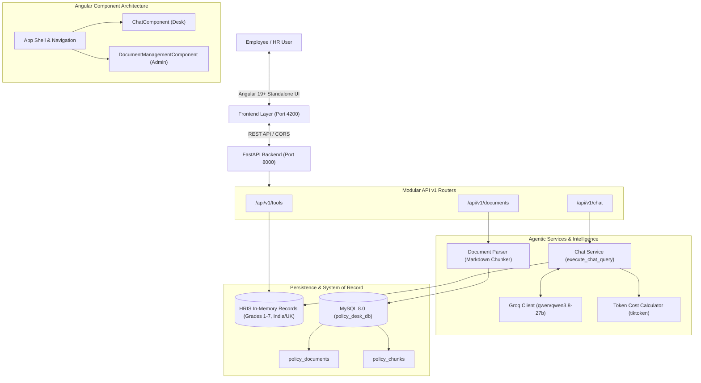

# HR Policy Answer Desk: Master Project & Architecture Guide

> **Project Track**: Track C — Enterprise HR Policy Answer Desk  
> **Status**: In Active Development (Milestones 1 & 2 Complete, Milestone 3 Part A Complete)  
> **Target Completion**: Tomorrow before 4:00 PM IST  
> **Last Updated**: 2026-10-18T19:05:00+05:30

---

## 1. Executive Summary & Problem Domain

### The Business Challenge
In multinational organizations operating across jurisdictions (e.g., India and the United Kingdom), employees constantly query HR regarding statutory and company entitlements:
- Leave balances, carryover limits, bereavement/compassionate policies, notice periods, and parental leaves.
- Policies differ sharply by **operating legal entity** (India vs UK statutory rules) and **seniority grade band** (Grades 1 through 7).
- Policies evolve across time: 2024 policies differ from 2025 amendments.

### The Failure Modes of Naive AI
When companies deploy naive chatbots without strict architecture, they suffer from:
1. **Hallucination**: Quoting nonexistent leave rules or fabricating entitlements.
2. **Jurisdictional Leakage**: Giving UK statutory rules to an employee contracted under Indian labor law.
3. **Temporal Inversion**: Answering based on superseded 2024 rules rather than active 2025 rules.
4. **Data Corruption**: Allowing generative models write access to transactional employee databases.
5. **Cost & Latency Explosion**: Stuffing entire 50-page handbooks into context windows.

### Our Architectural Solution
The **Policy Answer Desk** solves this by strictly separating **Transactional HRIS Tools (Structured Data)** from **Grounded RAG (Unstructured Policy Knowledge)**, governed by:
- Read-only controlled tools with Pydantic contract validation.
- Deterministic entity & grade scoping before policy retrieval.
- Semantic clause-level Markdown parsing stored in MySQL 8.0.
- Autonomous agentic tool orchestration powered by Groq (`qwen/qwen3.8-27b`).
- Angular 19+ modular standalone frontend with performance and tool execution observability.

---

## 2. End-to-End System Architecture

---

## 3. Detailed Milestone Progress & Implementation

### Milestone 1: Foundations & Core Mechanics (COMPLETE)

#### A. Pre-Flight Token Counting & Cost Modeling
- **File**: [`app/services/token_cost_calculator.py`](file:///C:/Users/StanA/OneDrive/Desktop/Projects/policy-answer-desk/backend/app/services/token_cost_calculator.py)
- **Mechanics**: Implements Byte-Pair Encoding (BPE) token counting using `tiktoken` (`cl100k_base` / `o200k_base`).
- **Cost Engine**: Computes exact USD costs:
  $$\text{Cost} = (\text{Prompt Tokens} \times \$0.0000002) + (\text{Completion Tokens} \times \$0.0000002)$$

#### B. Pydantic Data Contracts
- **File**: [`app/schemas/employee.py`](file:///C:/Users/StanA/OneDrive/Desktop/Projects/policy-answer-desk/backend/app/schemas/employee.py)
- **Models**:
  - `EmployeeRecord`: Strict fields (`employee_id`, `name`, `grade_band` [1–7], `entity` [`India` | `UK`], `tenure_years`, `accrued_leave_days`).
  - `LeaveBalanceResponse`: Read-only snapshot of approved accrued leave and pending requests.
  - `EscalationRequest` & `EscalationResponse`: Validated payload requiring at least 10 characters for discretionary reasoning.

#### C. Controlled HRIS Database Tools
- **File**: [`app/tools/employee_tool.py`](file:///C:/Users/StanA/OneDrive/Desktop/Projects/policy-answer-desk/backend/app/tools/employee_tool.py)
- **Controlled Functions**:
  1. `lookup_employee_record(employee_id)`: Case-insensitive resolver. Throws `EmployeeNotFoundError` on invalid IDs.
  2. `check_leave_balance(employee_id)`: Read-only balance extractor.
  3. `escalate_to_hrbp(...)`: Entity-aware router routing Indian employees to `Pooja Sharma (Lead HRBP - India)` and UK employees to `James Davies (Senior HRBP - UK)`, generating deterministic tickets like `TICK-INDIA-101-2026`.

#### D. Groq LLM Client
- **File**: [`app/services/llm_client.py`](file:///C:/Users/StanA/OneDrive/Desktop/Projects/policy-answer-desk/backend/app/services/llm_client.py)
- **Model**: `qwen/qwen3.8-27b` delivering ~0.31s latency on Groq's LPU architecture, supporting OpenAI-compatible function calling and tool schemas.

---

### Milestone 2: FastAPI & Angular Foundation (COMPLETE)

#### A. Modular Router Hierarchy
- **File**: [`app/main.py`](file:///C:/Users/StanA/OneDrive/Desktop/Projects/policy-answer-desk/backend/app/main.py)
- Separated endpoints into dedicated modules under `app/routers/`:
  - [`routers/tools.py`](file:///C:/Users/StanA/OneDrive/Desktop/Projects/policy-answer-desk/backend/app/routers/tools.py): Controlled HRIS REST endpoints.
  - [`routers/chat.py`](file:///C:/Users/StanA/OneDrive/Desktop/Projects/policy-answer-desk/backend/app/routers/chat.py): Single-turn conversation orchestrator.
  - [`routers/document.py`](file:///C:/Users/StanA/OneDrive/Desktop/Projects/policy-answer-desk/backend/app/routers/document.py): Ingestion and document management.
- Configured CORS for `http://localhost:4200`.

#### B. Autonomous Tool Orchestration
- **File**: [`app/services/chat_service.py`](file:///C:/Users/StanA/OneDrive/Desktop/Projects/policy-answer-desk/backend/app/services/chat_service.py)
- When a user asks a question, the LLM receives the system prompt and `POLICY_DESK_TOOLS` JSON schemas.
- If the model emits `tool_calls`, the backend executes the local Python function, wraps the result in a `tool` message, and performs a second-stage synthesis turn.

#### C. Angular 19+ Standalone Chat Interface
- **Files**: [`frontend/src/app/components/chat/`](file:///C:/Users/StanA/OneDrive/Desktop/Projects/policy-answer-desk/frontend/src/app/components/chat/)
- Features:
  - Active employee switcher (`EMP-101`, `EMP-102`, `EMP-103`, `EMP-104`).
  - Quick prompt toolbar.
  - Tool execution badges showing exact JSON inputs and outputs.
  - Telemetry metadata pills showing latency ($\le 2$s), tokens, model name, and cost ($\$$).

---

### Milestone 3 (Part A): Database & Ingestion Engine (COMPLETE)

#### A. MySQL 8.0 & SQLAlchemy Models
- **Database**: `policy_desk_db` running on port 3306.
- **Connection Factory**: [`app/db/database.py`](file:///C:/Users/StanA/OneDrive/Desktop/Projects/policy-answer-desk/backend/app/db/database.py) (`create_engine`, `SessionLocal`, `get_db` generator).
- **Relational Tables**: [`app/db/document.py`](file:///C:/Users/StanA/OneDrive/Desktop/Projects/policy-answer-desk/backend/app/db/document.py)
  - `PolicyDocument`: Parent document metadata (`id`, `title`, `filename`, `version`, `effective_date`, `entity`, `raw_content`, `is_active`, `uploaded_at`).
  - `PolicyChunk`: Child clause records (`id`, `document_id` [FK with `CASCADE`], `chunk_index`, `clause_id`, `content`, `token_count`).

#### B. Semantic Markdown Clause Parser
- **File**: [`app/services/document_parser.py`](file:///C:/Users/StanA/OneDrive/Desktop/Projects/policy-answer-desk/backend/app/services/document_parser.py)
- Uses regex heading pattern `(?m)^(#{1,4}\s+.+)$` to cleanly split documents into independent clauses.
- Assigns clause IDs (e.g. `Clause 1: Scope & Eligibility`) and calculates exact BPE token counts per chunk.

#### C. Multipart Ingestion Endpoints
- **File**: [`app/routers/document.py`](file:///C:/Users/StanA/OneDrive/Desktop/Projects/policy-answer-desk/backend/app/routers/document.py)
- `POST /api/v1/documents/upload`: Validates `.md`/`.txt`, parses clauses, and atomically saves document + chunks.
- `GET /api/v1/documents`: Lists all active policies with clause chunk counts.
- `DELETE /api/v1/documents/{id}`: Cascading deletion from MySQL.

#### D. Modular Frontend Component Split
- Refactored frontend into independent components:
  - [`ChatComponent`](file:///C:/Users/StanA/OneDrive/Desktop/Projects/policy-answer-desk/frontend/src/app/components/chat/chat.component.ts)
  - [`DocumentManagementComponent`](file:///C:/Users/StanA/OneDrive/Desktop/Projects/policy-answer-desk/frontend/src/app/components/document-management/document-management.component.ts)
  - [`App` Shell](file:///C:/Users/StanA/OneDrive/Desktop/Projects/policy-answer-desk/frontend/src/app/app.ts)

---

## 4. Test Suite & Verification Matrix

All 35 tests pass deterministically:

| Test Suite | File | Tests | Coverage Scope |
| :--- | :--- | :---: | :--- |
| **API Endpoints** | [`test_api_endpoints.py`](file:///C:/Users/StanA/OneDrive/Desktop/Projects/policy-answer-desk/backend/tests/test_api_endpoints.py) | 9 | `/health`, `/tools/employee-record`, `/tools/leave-balance`, `/tools/escalate-to-hrbp`, `/chat` with tool calling |
| **Database & ORM** | [`test_database.py`](file:///C:/Users/StanA/OneDrive/Desktop/Projects/policy-answer-desk/backend/tests/test_database.py) | 2 | Live MySQL connection, cascading chunk insertion, filtered querying, cascading delete |
| **Document Ingestion** | [`test_document_endpoints.py`](file:///C:/Users/StanA/OneDrive/Desktop/Projects/policy-answer-desk/backend/tests/test_document_endpoints.py) | 4 | Multipart upload, Markdown clause parsing, chunk counts, invalid file handling, 404 handling |
| **HRIS Tools** | [`test_employee_tool.py`](file:///C:/Users/StanA/OneDrive/Desktop/Projects/policy-answer-desk/backend/tests/test_employee_tool.py) | 11 | Grade validation (1-7), India/UK routing, case-insensitivity, ticket ID formats |
| **LLM Client** | [`test_llm_client.py`](file:///C:/Users/StanA/OneDrive/Desktop/Projects/policy-answer-desk/backend/tests/test_llm_client.py) | 2 | Real API call to Groq, tool-calling response structure |
| **Token Calculator** | [`test_token_calculator.py`](file:///C:/Users/StanA/OneDrive/Desktop/Projects/policy-answer-desk/backend/tests/test_token_calculator.py) | 7 | BPE counting, pricing calculations, edge cases (empty strings) |
| **Total** | | **35 Passed** | **Execution Time: ~4.3s** |

---

## 5. Upcoming Milestones Roadmap (To Be Updated)

- [ ] **Milestone 3 (Part B)**: User codes Document Upload UI $\to$ Semantic search tool $\to$ Grounded generation with strict citations.
- [ ] **Milestone 4**: Temporal conflict resolution (2024 vs 2025 policies) & jurisdictional override.
- [ ] **Milestone 5**: 4-Budget Agent Loop (Latency, Token, Cost, Step limits).
- [ ] **Milestone 6**: Model Context Protocol (MCP) server integration.
- [ ] **Milestone 7**: Golden Dataset Eval Harness ($\ge 85\%$ judge agreement).
- [ ] **Milestone 8**: Multi-Agent Race & Fallback Routing.
- [ ] **Milestone 9**: Observability, Telemetry & PII Redaction.
- [ ] **Milestone 10**: Adversarial Red Teaming & Jailbreak Prevention.
- [ ] **Milestone 11**: Production Containerization & CI/CD.
- [ ] **Milestone 12**: Capstone Architecture Defense & Final Review.
